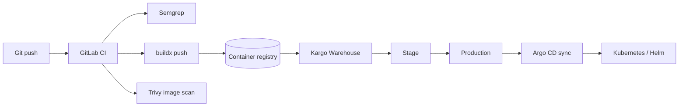

# Cloud-Native GitOps Reference (Anonymized)

Portfolio samples that mirror how I build and operate production workloads: **GitLab CI → container registry → Kargo → Argo CD → Helm on Kubernetes**, with **Semgrep** and **Trivy** in the pipeline.

> Patterns are based on real government and commercial microservice estates. Hostnames, registry URLs, and secrets are **fictional or redacted**.

## Architecture

## What's in this repo

| Path | Description |
|------|-------------|
| [`examples/gitlab-ci.yml`](examples/gitlab-ci.yml) | Multi-stage pipeline: SAST, unit build, buildx push, Trivy, optional Kargo warehouse refresh |
| [`examples/helm-values.yaml`](examples/helm-values.yaml) | Helm values: image, pull secrets, probes, resources, security context |
| [`examples/argocd-application.yaml`](examples/argocd-application.yaml) | Argo CD Application with automated sync and Kargo stage authorization |
| [`examples/ingress-snippet.yaml`](examples/ingress-snippet.yaml) | Nginx Ingress + service routing pattern |
| [`examples/qris-stack.md`](examples/qris-stack.md) | QRIS payment stack: Ingress → KrakenD → microservices (diagram + ops notes) |
| [`examples/qris-krakend-gateway-excerpt.json`](examples/qris-krakend-gateway-excerpt.json) | KrakenD JWT + backend routing excerpt |
| [`examples/qris-ingress-values.yaml`](examples/qris-ingress-values.yaml) | Helm values for gateway Ingress/TLS |

## Related public work

- [Golang REST API — Docker, CI, Prometheus](https://github.com/achmadbaund/Golang-REST-API-Fiber-PostgreSQL-Redis)

## Author

**Achmad Mambaun Niam, S.Kom** — DevOps / Platform (Kubernetes, GitOps, CI/CD)
