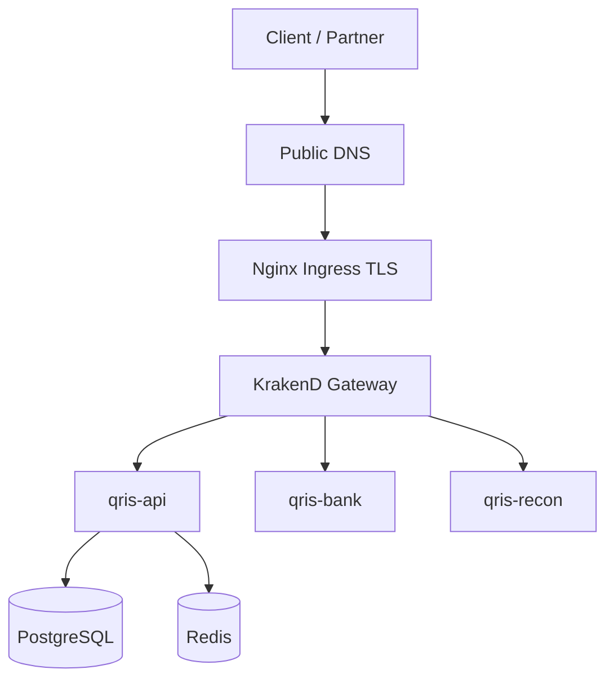

# QRIS-style payment stack (anonymized)

Reference layout for a **QRIS payment platform**: multiple microservices behind **KrakenD**, exposed via **Nginx Ingress**, deployed with **Helm + Argo CD**.

## Traffic flow

## Gateway config

[`qris-krakend-gateway-excerpt.json`](qris-krakend-gateway-excerpt.json) shows:

- OAuth2/JWT validation at the edge (`auth/validator`, JWKS URL)
- In-cluster backends via Kubernetes DNS (`*.svc.cluster.local`)
- Path prefix `/api/qris/v1/*` mapped to internal `url_pattern`s

In production we version this JSON in Git, render it through a **Helm ConfigMap** template, and sync with **Argo CD** (same GitOps model as `argocd-application.yaml`).

## Ingress (north-south)

[`qris-ingress-values.yaml`](qris-ingress-values.yaml) — host, TLS, and gateway Service behind Ingress.

## Post-deploy verification (pattern)

After each gateway or backend release:

| Check | Purpose |
|-------|---------|
| `GET /api/qris/v1/health` | Auth + backend reachability |
| Sample CRUD on `/payments`, `/institutions` | Routing and schema alignment |
| Compare gateway revision in Argo CD | Confirm synced config |

In a full regression pass we exercised **28+ routes** through KrakenD (JWT OK, no 500 from misrouted backends). Numbers and hostnames here are illustrative only.

## Application CI (same estate)

Microservices use the same pipeline pattern as [`gitlab-ci.yml`](gitlab-ci.yml): image build → registry → Kargo warehouse → Argo CD Helm upgrade. Gateway and API images promote independently but share the promotion stages.
